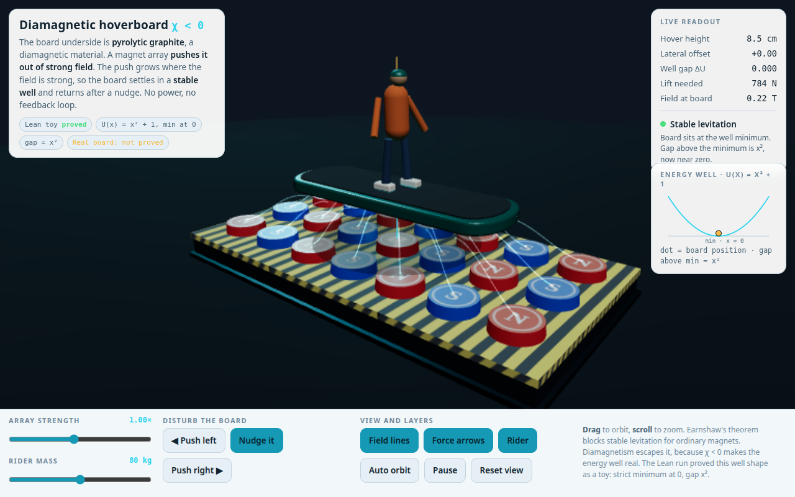

# Hoverboard Lean

Lean 4 checks of hoverboard levitation claims.

No real hoverboard is proved here. Lean proves only the small models below. The full proofs stay open. Read the Not proved list below first.

## Visual showcase



Try the interactive 3D version: [Diamagnetic hoverboard 3D](https://muse.ai/s/diamagnetic-hoverboard-3d-xua6xkhxutxyx0xy6/H0I15EXB8601mdIEbGT-jGTN2AuN1pncnIR7HngBf_E)

- Move the sliders to change magnet strength and rider mass.
- Push the board sideways with the push buttons.
- Watch it settle back to centre.

## Lean results

- Diamagnetic levitation, Nat toy: U(n) = n*n + 1 has a strict minimum at 0.
- Diamagnetic levitation, Real toy: U(x) = x^2 + 1 has a strict minimum at 0.
- Anti-gravity, Int toy: a repulsive push needs a negative energy density.
- All three toys check in Lean with no sorry and no sorryAx.

## Proved

- The Nat toy has a global strict minimum at 0, with gap n*n.
- The Real toy has a global strict minimum at 0, with gap x^2.
- The Real toy applies to the Real spec instance, realSystem.
- The Int toy shows a repulsive value forces rho below 0.
- Each spec file states its full target theorem, with one sorry left.

## Not proved

- No room-temperature superconductor is proved.
- No anti-gravity drive is proved.
- No WarpHoverMetric that lifts 80 kg is proved.
- No Navier-Stokes regularity result is proved.
- No lab test exists for any of these models.
- The full target theorem in each spec still holds a sorry.

## 01. Diamagnetic levitation, Nat

- Folder: 01-diamagnetic-nat
- Lean: 4.23.0, Lean core only, no Mathlib.
- Spec: Diamagnetic_Spec.lean, 152 lines, one sorry at the target theorem.
- Toy: Diamagnetic_Toy.lean, 93 lines, no sorry, no sorryAx.
- Toy result: U(n) = n*n + 1 has a strict minimum at 0.
- Check: lean Diamagnetic_Spec.lean, then lean Diamagnetic_Toy.lean.

## 02. Anti-gravity, Int

- Folder: 02-anti-gravity
- Lean: 4.23.0, Lean core only, no Mathlib.
- Spec: AntiGravity_Spec.lean, 113 lines, one sorry at localized_repulsive_gravity_requires_exotic_matter.
- Toy: AntiGravity_Toy.lean, 101 lines, no sorry, no sorryAx.
- Toy result: if a = -rho and 0 < a, then rho < 0, witness (1, -1).
- Check: lean AntiGravity_Spec.lean, then lean AntiGravity_Toy.lean.

## 03. Diamagnetic levitation, Real

- Folder: 03-diamagnetic-real
- Lean: 4.23.0, Lake 5.0.0, Mathlib v4.23.0, commit 37df177a.
- Spec: Diamagnetic_Real_Spec.lean, 114 lines, one sorry at the target theorem.
- Spec uses gravity 9.8 and chi -1, with chi below 0.
- Chi -1 is a stand-in, not a measured material value.
- Toy: Diamagnetic_Real_Toy.lean, 58 lines, no sorry, no sorryAx.
- Toy result: U(x) = x^2 + 1 over Real has a strict minimum at 0, gap x^2.
- Check: cd 03-diamagnetic-real, then lake env lean HoverboardMathlib/Diamagnetic_Real_Toy.lean.
- Note: full import Mathlib fails here, Mathlib.olean does not exist in the cached build. This project uses only Mathlib.Data.Real.Sqrt, Mathlib.Tactic.Ring, and Mathlib.Tactic.Linarith. A fresh clone needs to fetch the Mathlib cache first.

## How to check

- Run 01: cd 01-diamagnetic-nat, run lean on the spec and toy files.
- Run 02: cd 02-anti-gravity, run lean on the spec and toy files.
- Run 03: cd 03-diamagnetic-real, run lake env lean on the spec and toy files.
- See VERIFICATION.md for the exact exit codes and logs.

## How to cite

Please cite this repository and the original sources you use. Credit the scholars listed in each target folder for their work.

```bibtex
@misc{dackam_hoverboard_lean,
  author       = {Dackam, Richardson},
  title        = {Hoverboard Lean: Lean 4 checks of hoverboard levitation claims},
  howpublished = {GitHub repository},
  note         = {Add the date you accessed it}
}
```

## Author

Richardson Dackam is an independent researcher in Toronto, Canada.

- LinkedIn: https://linkedin.com/in/richardsondx
- X: https://x.com/RichardsonDx

## License

MIT, see LICENSE.
